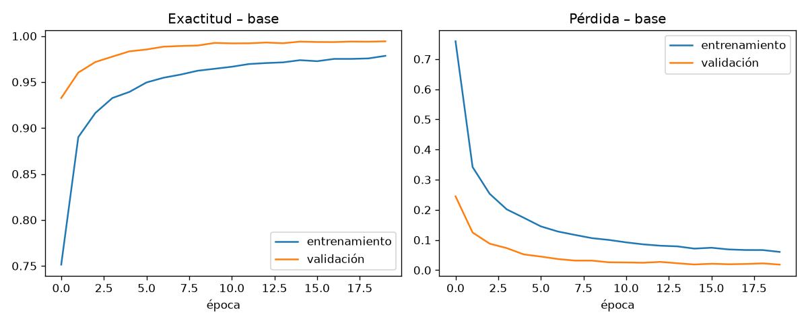
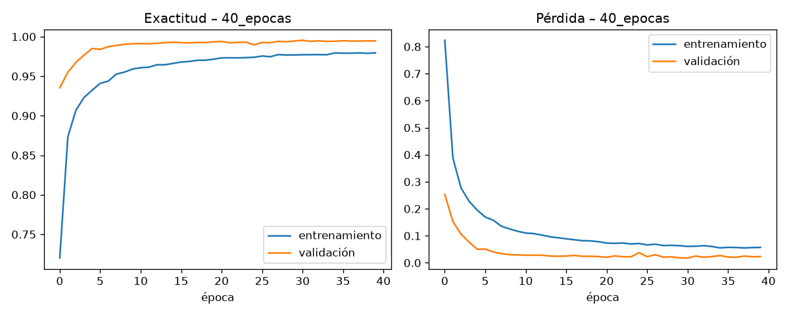
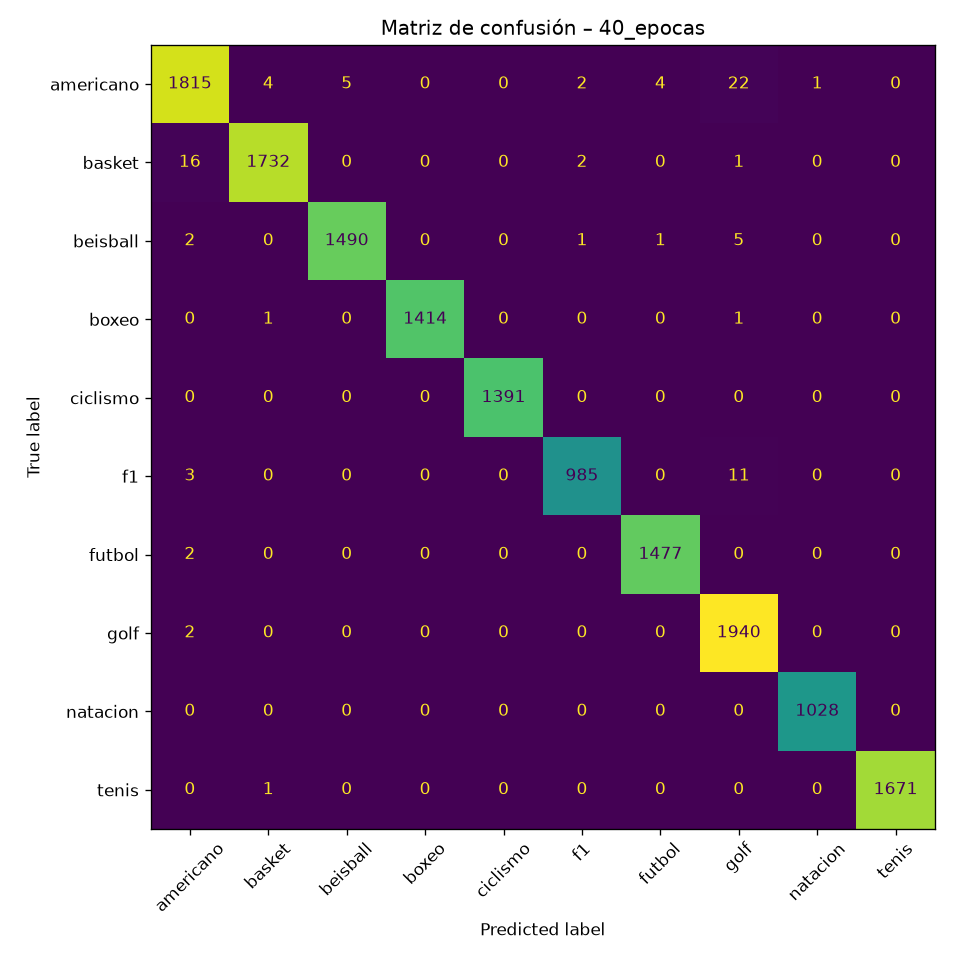
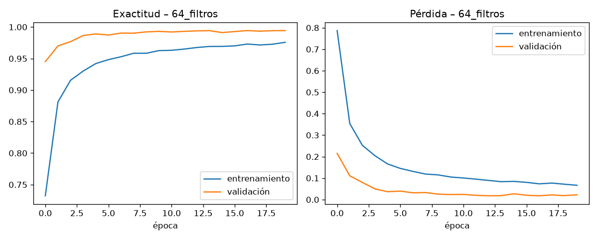
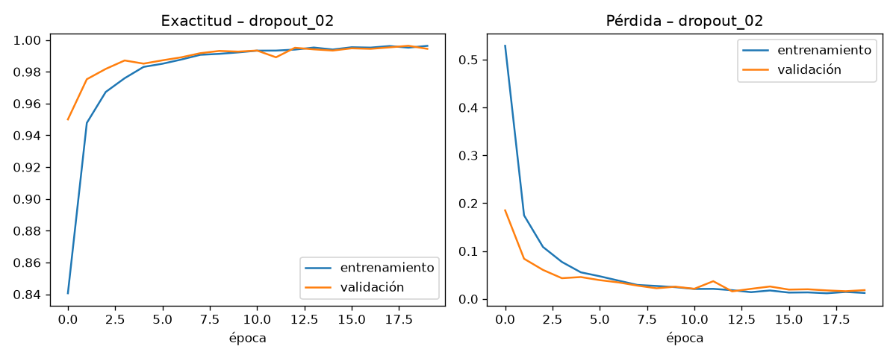
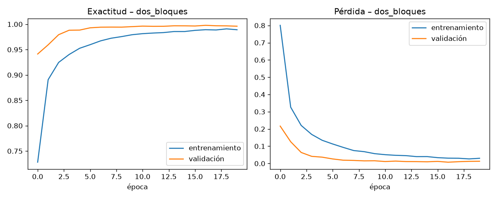
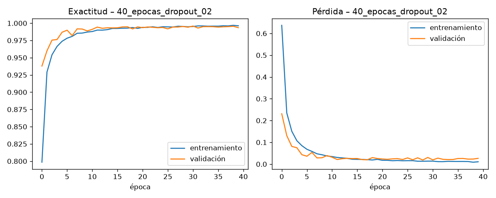
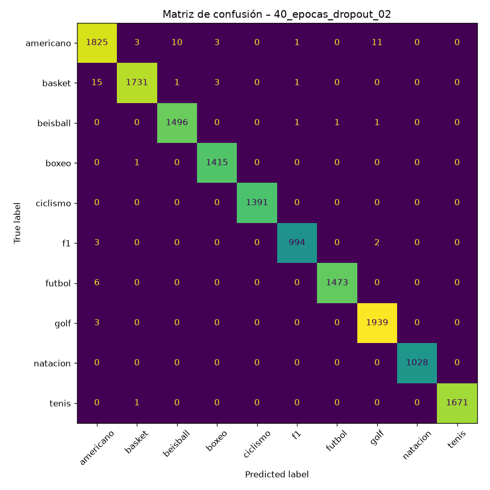

# Comparación de corridas: CNN de clasificación de deportes

**Nombre:** José Antonio Medina Ayala

---

## Resumen

| Corrida | Qué se cambió | Exactitud | F1 promedio | Deporte más débil (recall) |
|---|---|---|---|---|
| Base | Nada, es la referencia | 99.5 % | 1.00 | americano (97.8 %) |
| 40 épocas | 40 épocas en vez de 20 | 99.4 % | 0.99 | americano (97.9 %) |
| 64 filtros | 64 filtros en vez de 32 | 99.6 % | 1.00 | f1 (98.9 %) |
| Dropout 0.2 | Dropout de 0.2 en vez de 0.5 | 99.6 % | 1.00 | f1 (98.4 %) |
| Dos bloques de convolución | Se agregó un segundo bloque Conv2D + MaxPooling | 99.6 % | 1.00 | americano (98.1 %) |
| 40 épocas + Dropout 0.2 | Las dos mejoras juntas | 99.6 % | 1.00 | americano (98.5 %) |

**Cómo leer las tablas:**

- **Precisión:** de las fotos que la red etiquetó como ese deporte, cuántas sí lo eran.
- **Recall:** de todas las fotos reales de ese deporte, cuántas encontró.
- **F1:** combina precisión y recall en un solo número.
- Se considera **alto** un valor de 80 % o más.

---

## Corrida por corrida

### Base

**Observaciones:**

- La curva de validación queda por encima de la de entrenamiento durante todo el entrenamiento. No es un error: el Dropout de 0.5 solo apaga neuronas al entrenar, así que la red trabaja "con desventaja" en entrenamiento y completa al validar.
- La validación se estabiliza alrededor de la época 10 (≈ 99.3 %) y desde ahí casi no cambia, así que 20 épocas fueron suficientes.
- En la matriz, los errores se concentran en dos confusiones: 17 fotos de americano y 11 de f1 se clasificaron como golf. Por eso golf tiene la precisión más baja (98.5 %) y americano el recall más bajo (97.8 %).

**Reporte completo:**

| Deporte | Precisión | Recall | F1 | Fotos |
|---|---|---|---|---|
| americano | 0.99 | 0.98 | 0.98 | 1,853 |
| basket | 1.00 | 0.99 | 1.00 | 1,751 |
| beisball | 0.99 | 1.00 | 1.00 | 1,499 |
| boxeo | 1.00 | 1.00 | 1.00 | 1,416 |
| ciclismo | 1.00 | 1.00 | 1.00 | 1,391 |
| f1 | 0.99 | 0.99 | 0.99 | 999 |
| futbol | 1.00 | 1.00 | 1.00 | 1,479 |
| golf | 0.98 | 1.00 | 0.99 | 1,942 |
| natacion | 1.00 | 1.00 | 1.00 | 1,028 |
| tenis | 1.00 | 1.00 | 1.00 | 1,672 |
| **Exactitud total** | | | 0.99 | 15,030 |
| Promedio simple | 1.00 | 1.00 | 1.00 | 15,030 |
| Promedio ponderado | 0.99 | 0.99 | 0.99 | 15,030 |

**Clasificación por deporte:**

- **Alta precisión y alto recall:** americano, basket, beisball, boxeo, ciclismo, f1, futbol, golf, natacion, tenis
- **Alta precisión y bajo recall:** ninguno
- **Baja precisión y alto recall:** ninguno
- **Baja precisión y bajo recall:** ninguno

### 40 épocas

**Observaciones:**

- Duplicar las épocas no mejoró: la exactitud quedó en 99.4 %, prácticamente igual que la base (99.5 %).
- En la gráfica la validación ya está plana desde la época 10 a la 15; las 20 épocas extra solo agregan tiempo de entrenamiento.
- Golf sigue con la precisión más baja (98.0 %), lo que indica que sigue recibiendo fotos de otros deportes, sobre todo de americano.

**Reporte completo:**

| Deporte | Precisión | Recall | F1 | Fotos |
|---|---|---|---|---|
| americano | 0.99 | 0.98 | 0.98 | 1,853 |
| basket | 1.00 | 0.99 | 0.99 | 1,751 |
| beisball | 1.00 | 0.99 | 1.00 | 1,499 |
| boxeo | 1.00 | 1.00 | 1.00 | 1,416 |
| ciclismo | 1.00 | 1.00 | 1.00 | 1,391 |
| f1 | 0.99 | 0.99 | 0.99 | 999 |
| futbol | 1.00 | 1.00 | 1.00 | 1,479 |
| golf | 0.98 | 1.00 | 0.99 | 1,942 |
| natacion | 1.00 | 1.00 | 1.00 | 1,028 |
| tenis | 1.00 | 1.00 | 1.00 | 1,672 |
| **Exactitud total** | | | 0.99 | 15,030 |
| Promedio simple | 1.00 | 0.99 | 0.99 | 15,030 |
| Promedio ponderado | 0.99 | 0.99 | 0.99 | 15,030 |

**Clasificación por deporte:**

- **Alta precisión y alto recall:** americano, basket, beisball, boxeo, ciclismo, f1, futbol, golf, natacion, tenis
- **Alta precisión y bajo recall:** ninguno
- **Baja precisión y alto recall:** ninguno
- **Baja precisión y bajo recall:** ninguno

### 64 filtros

**Observaciones:**

- Con el doble de filtros la exactitud subió a 99.6 %, una mejora de solo 0.1 puntos sobre la base (unas 15 fotos de 15,030).
- Americano mejoró su recall de 97.8 % a 99.3 %, pero a cambio bajó su precisión a 98.1 %: ahora la red se equivoca menos al dejar fotos de americano fuera, pero mete más fotos de otros deportes como americano.
- El deporte más débil pasó a ser f1 (recall 98.9 %).

**Reporte completo:**

| Deporte | Precisión | Recall | F1 | Fotos |
|---|---|---|---|---|
| americano | 0.98 | 0.99 | 0.99 | 1,853 |
| basket | 1.00 | 0.99 | 1.00 | 1,751 |
| beisball | 1.00 | 1.00 | 1.00 | 1,499 |
| boxeo | 1.00 | 1.00 | 1.00 | 1,416 |
| ciclismo | 1.00 | 1.00 | 1.00 | 1,391 |
| f1 | 1.00 | 0.99 | 0.99 | 999 |
| futbol | 1.00 | 1.00 | 1.00 | 1,479 |
| golf | 0.99 | 0.99 | 0.99 | 1,942 |
| natacion | 1.00 | 1.00 | 1.00 | 1,028 |
| tenis | 1.00 | 1.00 | 1.00 | 1,672 |
| **Exactitud total** | | | 1.00 | 15,030 |
| Promedio simple | 1.00 | 1.00 | 1.00 | 15,030 |
| Promedio ponderado | 1.00 | 1.00 | 1.00 | 15,030 |

**Clasificación por deporte:**

- **Alta precisión y alto recall:** americano, basket, beisball, boxeo, ciclismo, f1, futbol, golf, natacion, tenis
- **Alta precisión y bajo recall:** ninguno
- **Baja precisión y alto recall:** ninguno
- **Baja precisión y bajo recall:** ninguno

### Dropout 0.2

**Observaciones:**

- Bajar el Dropout de 0.5 a 0.2 dio 99.6 %, igual que la mejor corrida.
- Con menos neuronas apagadas, la red aprende más rápido en entrenamiento y las curvas de entrenamiento y validación quedan más juntas.
- f1 fue el deporte con menor recall (98.4 %); el resto de los deportes quedó en 98.8 % o más.

**Reporte completo:**

| Deporte | Precisión | Recall | F1 | Fotos |
|---|---|---|---|---|
| americano | 0.99 | 0.99 | 0.99 | 1,853 |
| basket | 0.99 | 1.00 | 1.00 | 1,751 |
| beisball | 1.00 | 1.00 | 1.00 | 1,499 |
| boxeo | 1.00 | 1.00 | 1.00 | 1,416 |
| ciclismo | 1.00 | 1.00 | 1.00 | 1,391 |
| f1 | 0.99 | 0.98 | 0.99 | 999 |
| futbol | 1.00 | 1.00 | 1.00 | 1,479 |
| golf | 0.99 | 1.00 | 0.99 | 1,942 |
| natacion | 1.00 | 1.00 | 1.00 | 1,028 |
| tenis | 1.00 | 1.00 | 1.00 | 1,672 |
| **Exactitud total** | | | 1.00 | 15,030 |
| Promedio simple | 1.00 | 1.00 | 1.00 | 15,030 |
| Promedio ponderado | 1.00 | 1.00 | 1.00 | 15,030 |

**Clasificación por deporte:**

- **Alta precisión y alto recall:** americano, basket, beisball, boxeo, ciclismo, f1, futbol, golf, natacion, tenis
- **Alta precisión y bajo recall:** ninguno
- **Baja precisión y alto recall:** ninguno
- **Baja precisión y bajo recall:** ninguno

### Dos bloques de convolución

**Observaciones:**

- El segundo bloque de convolución empató con la mejor exactitud (99.6 %).
- En la gráfica, la exactitud de entrenamiento llega más alto que en la base (≈ 99 % contra ≈ 98 %), porque la red tiene más capacidad para encontrar patrones.
- Americano tiene la precisión más alta de todas las corridas (99.7 %), pero su recall (98.1 %) sigue siendo el más bajo: casi no se inventa fotos de americano, pero todavía se le escapan algunas, en su mayoría hacia golf (precisión de golf: 98.0 %).

**Reporte completo:**

| Deporte | Precisión | Recall | F1 | Fotos |
|---|---|---|---|---|
| americano | 1.00 | 0.98 | 0.99 | 1,853 |
| basket | 1.00 | 1.00 | 1.00 | 1,751 |
| beisball | 1.00 | 1.00 | 1.00 | 1,499 |
| boxeo | 1.00 | 1.00 | 1.00 | 1,416 |
| ciclismo | 1.00 | 1.00 | 1.00 | 1,391 |
| f1 | 1.00 | 0.99 | 0.99 | 999 |
| futbol | 1.00 | 1.00 | 1.00 | 1,479 |
| golf | 0.98 | 1.00 | 0.99 | 1,942 |
| natacion | 1.00 | 1.00 | 1.00 | 1,028 |
| tenis | 1.00 | 1.00 | 1.00 | 1,672 |
| **Exactitud total** | | | 1.00 | 15,030 |
| Promedio simple | 1.00 | 1.00 | 1.00 | 15,030 |
| Promedio ponderado | 1.00 | 1.00 | 1.00 | 15,030 |

**Clasificación por deporte:**

- **Alta precisión y alto recall:** americano, basket, beisball, boxeo, ciclismo, f1, futbol, golf, natacion, tenis
- **Alta precisión y bajo recall:** ninguno
- **Baja precisión y alto recall:** ninguno
- **Baja precisión y bajo recall:** ninguno

### 40 épocas + Dropout 0.2

**Observaciones:**

- Juntar las dos mejoras dio 99.55 %, prácticamente igual a las mejores corridas individuales.
- Es la corrida más pareja: ningún deporte baja de 98.5 % de recall y f1 alcanzó su mejor recall (99.5 %).
- Al igual que con 40 épocas, las épocas extra no se ven reflejadas en la exactitud general.

**Reporte completo:**

| Deporte | Precisión | Recall | F1 | Fotos |
|---|---|---|---|---|
| americano | 0.99 | 0.98 | 0.99 | 1,853 |
| basket | 1.00 | 0.99 | 0.99 | 1,751 |
| beisball | 0.99 | 1.00 | 1.00 | 1,499 |
| boxeo | 1.00 | 1.00 | 1.00 | 1,416 |
| ciclismo | 1.00 | 1.00 | 1.00 | 1,391 |
| f1 | 1.00 | 0.99 | 1.00 | 999 |
| futbol | 1.00 | 1.00 | 1.00 | 1,479 |
| golf | 0.99 | 1.00 | 1.00 | 1,942 |
| natacion | 1.00 | 1.00 | 1.00 | 1,028 |
| tenis | 1.00 | 1.00 | 1.00 | 1,672 |
| **Exactitud total** | | | 1.00 | 15,030 |
| Promedio simple | 1.00 | 1.00 | 1.00 | 15,030 |
| Promedio ponderado | 1.00 | 1.00 | 1.00 | 15,030 |

**Clasificación por deporte:**

- **Alta precisión y alto recall:** americano, basket, beisball, boxeo, ciclismo, f1, futbol, golf, natacion, tenis
- **Alta precisión y bajo recall:** ninguno
- **Baja precisión y alto recall:** ninguno
- **Baja precisión y bajo recall:** ninguno

---

## Comparación: qué mejoró y qué empeoró

Las seis corridas quedaron entre **99.4 % y 99.6 %** de exactitud. En el conjunto de prueba, 0.1 % equivale a unas 15 fotos, así que las diferencias entre corridas son muy pequeñas y, con una sola corrida por configuración, pueden deberse al azar.

- **Más épocas (40):** no mejoró. La validación ya se había estabilizado antes de la época 20.
- **Más filtros (64):** mejoró un poco (+0.1 %). Ayudó a encontrar más fotos de americano, pero a cambio la red marcó más fotos de otros deportes como americano.
- **Menos Dropout (0.2):** mejoró un poco (+0.1 %) y aprende más rápido.
- **Dos bloques de convolución:** mejoró un poco (+0.1 %) y es la que mejor separa americano de otros deportes en precisión.
- **40 épocas + Dropout 0.2:** quedó igual que las mejores y es la más pareja entre deportes, pero las épocas extra no aportaron.

En todas las corridas se repite el mismo patrón: los errores casi siempre son fotos de **americano** y **f1** clasificadas como **golf**. Natación, tenis y ciclismo se clasifican prácticamente perfecto en todos los casos.

## Conclusión

Las corridas con mejor exactitud fueron **64 filtros, Dropout 0.2 y dos bloques (99.6 %)**. Si hay que elegir una, **Dropout 0.2** es la más conveniente: llega a la misma exactitud con 20 épocas y sin hacer el modelo más grande.

Un resultado arriba del 99 % con imágenes de 21 × 28 píxeles es sospechosamente alto. El notebook ya elimina las fotos **idénticas** (se excluyeron 1,982 duplicados), pero si el dataset viene de cuadros de video, puede haber fotos **casi idénticas** (cuadros seguidos de la misma escena) repartidas entre entrenamiento y prueba. En ese caso la red no estaría generalizando, sino reconociendo escenas que ya vio.
